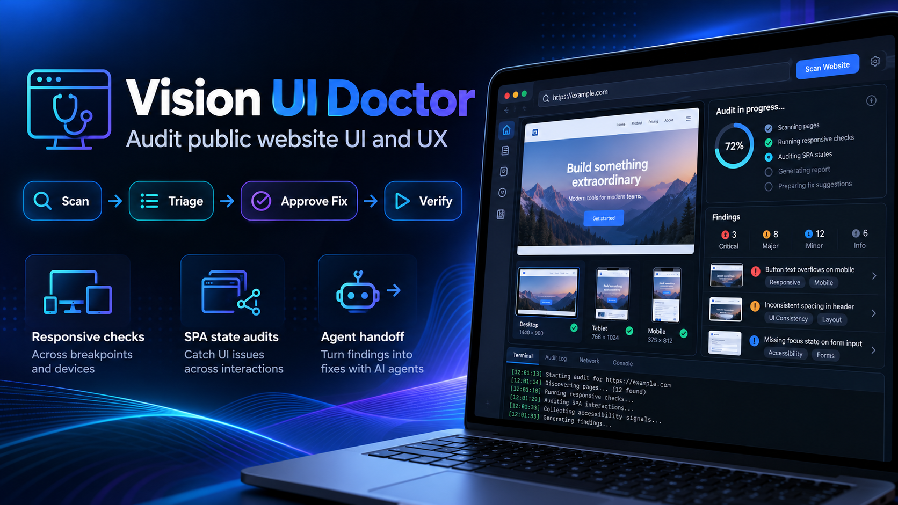
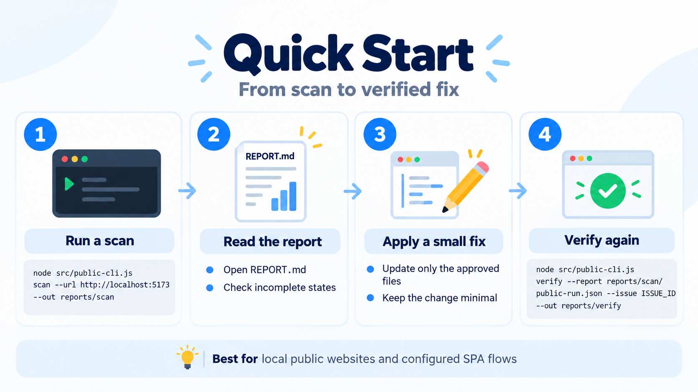
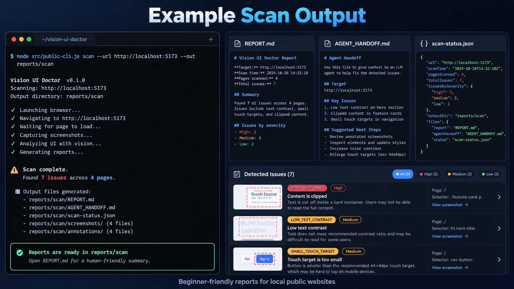

*Generated conceptual illustration — not an existing dashboard, actual scanner screenshot, or real diagnostic result.*

# Vision UI Doctor

**Vision UI Doctor checks your public website for possible layout and usability problems and saves reports you can read.**

It is a **command-line tool (CLI)**: you type commands in PowerShell, rather than use a graphical dashboard.

- Check layouts at different screen sizes.
- Scan public pages and explicitly configured website interactions.
- Read findings and see which pages or states could not be checked.
- Optionally let an AI coding agent explain the evidence and help with approved fixes.

**Public Beta: 0.2.0-beta.1** · [GitHub](https://github.com/visionnumbers/vision-ui-doctor) · [npm package](https://www.npmjs.com/package/vision-ui-doctor) · [Beta release](https://github.com/visionnumbers/vision-ui-doctor/releases/tag/v0.2.0-beta.1)

> This is a beta, not a guarantee that your whole website is correct. It can have browser timeouts or incomplete coverage. Scanning does not automatically change your website.

## What do I need?

This tutorial uses **Windows PowerShell**, the verified Windows Direct-Node method.

- A Windows PC with PowerShell.
- **Node.js 22 or newer**, including npm: [official Node.js download](https://nodejs.org/en/download).
- **Google Chrome or Chromium** installed: [official Chrome download](https://www.google.com/chrome/).
- Internet access to download Vision UI Doctor from npm.
- An existing **local public website** to scan — one that runs on your computer and does not need a login.

**You do not need to download a GitHub ZIP, clone this repository, or install an AI agent.**

After installing Node.js, open PowerShell from the Windows Start menu. If PowerShell was already open, close and reopen it before continuing.

## Install in two steps



*Generated conceptual illustration, not a real scan result. The image shows source-checkout example commands; use the actual npm instructions below instead. A fix needs your approval and fresh verification.*

Keep **the same PowerShell window open** throughout the tutorial. Paste each block separately and wait for it to finish.

### Step 1: Download and install

```powershell
$prefix = Join-Path $HOME 'vision-ui-doctor'
npm.cmd install --prefix $prefix --global=false --ignore-scripts --no-audit --no-fund --no-package-lock --save=false vision-ui-doctor@0.2.0-beta.1
```

**npm automatically downloads and installs Vision UI Doctor for you.**

`$prefix` is the local installation folder inside your Windows home folder, **not a download URL**. This works without a D: drive or a pre-existing Tools folder.

### Step 2: Remember the commands and check the version

```powershell
$vud = Join-Path $prefix 'node_modules/vision-ui-doctor/src/public-cli.js'
$installer = Join-Path $prefix 'node_modules/vision-ui-doctor/src/cli.js'
node $vud --version
```

You should see `0.2.0-beta.1`.

`$vud` and `$installer` are just **PowerShell variables that remember local file paths**. You do not need to create files with those names. `$vud` runs scans; `$installer` installs the optional Agent Skill.

If you close this window, open a new one and run the first line from Step 1 and the full Step 2 block again to restore those variables. You do not need to reinstall each time.

## Scan your first website

### 1. Start your website

In a **separate terminal**, open your existing website project and start it as you normally do.

For example, an existing Vite project may use:

```powershell
npm run dev
```

Use your project's own instructions if it starts differently. Keep that server terminal open. Find the URL it prints, and check that the website opens in Chrome.

### 2. Run the scan

Return to the **original PowerShell window** where you set `$vud`.

Reports are saved relative to the folder PowerShell is currently in. If you want them inside your website project, change to that project folder first. You can copy its folder address from File Explorer and use `Set-Location 'your copied folder address'`, replacing the example text with the real address.

Then run:

```powershell
node $vud scan --url http://localhost:5173 --out reports/scan
```

- Replace `http://localhost:5173` with **your website's actual URL**.
- The website must **already be running**. Vision UI Doctor does not start it for you.
- `reports/scan` is the output folder beneath your current PowerShell folder, not beneath the tool's installation folder.
- If you already have a scan there, choose a fresh output folder, such as `reports/scan-2`. Existing results are not overwritten.

A scan may report findings or incomplete states and return a nonzero exit code. That does **not** automatically mean your website is broken; check the report to see what happened.

## Understand your results

| File | In plain English |
| --- | --- |
| `REPORT.md` | Human-readable findings. **Start here.** |
| `AGENT_HANDOFF.md` | A short evidence summary for an AI coding agent. |
| `scan-status.json` | The scan outcome and how much was checked. |
| `public-run.json` | The detailed baseline, when the scan completes. |

Open the report from the same PowerShell folder:

```powershell
notepad reports/scan/REPORT.md
```

If you used another output folder, change that path too. Runtime or browser failures can leave an incomplete report without a detailed baseline.

When reading the report:

- **Confirmed:** the scanner measured a supported condition. Read the evidence; this is not a promise of complete visual correctness.
- **Probable:** a possible problem that needs checking on the page before a fix.
- **Needs-review:** someone needs to judge the intended design or behavior.
- **Incomplete:** a page or interaction could not be fully checked. It is **unknown, not clean**.
- **Unsupported:** a check could not assess something reliably; it is not a pass.

A missing finding in an incomplete state does not prove a fix. Additional pages and interactive states may need explicit configuration; a clean report is not a full-site guarantee.

## Install the AI Agent Skill — optional

**You can scan and read reports without any AI agent.**

An Agent Skill is a small set of instructions that helps a coding agent use your installed scanner, explain the findings, ask before changing your source, and verify approved fixes.

**Install the scanner first**, using the two steps above. Then, in the same PowerShell window, change to **the website project folder** and run the command for your agent:

| Your coding agent | Command |
| --- | --- |
| OpenAI Codex | `node $installer install --agent codex --scope project` |
| Claude Code | `node $installer install --agent claude-code --scope project` |
| Gemini CLI | `node $installer install --agent gemini-cli --scope project` |
| Google Antigravity | `node $installer install --agent antigravity --scope project` |
| Cursor | `node $installer install --agent cursor --scope project` |

Run just the command for the agent you use. `--scope project` means the skill belongs to that website project. If you cannot run from its folder, add `--project-root 'your website folder address'`, replacing that example with the real path.

The skill installer does **not** download Node.js, Chrome or the scanner. Keep the scanner in its installation folder after binding it to a skill.

If you opened another PowerShell window, restore `$prefix` and `$installer` as described in Step 2 before running the command.

Refresh or restart your agent chat if the skill is not discovered. Supported installation adapters do **not** mean every version of every agent host has verified compatibility.

Then ask your agent:

> Use Vision UI Doctor to scan my website, explain the important UI problems, and ask before making any changes. Verify approved fixes.

The agent needs your actual website URL. Source edits require your approval; scanning or installing the skill alone does not authorize a fix, commit, push or deployment.

## About the generated images

The hero and quick-start images above are **generated conceptual illustrations**, not actual scanner screenshots, real findings, or an existing GUI. Follow the written commands in this README rather than the image's example commands.

<details>
<summary>Optional generated report mockup — not actual scan output</summary>



The counts, findings, version labels and presentation in this image are fictional. It is not the current report format or evidence of a real scan. Read the files from your own run to assess results and coverage.

</details>

## Troubleshooting / FAQ

### Do I need to download the repository from GitHub?

No. The npm command in Step 1 downloads the package for you. GitHub is for documentation, source code and feedback.

### What does $prefix mean?

It is a PowerShell variable containing your local installation folder. It is not a website address, and you do not need a D: drive.

### Why is localhost:5173 not opening?

Your website may not be running, or it may use a different port. Start its development server, keep it running, and use the exact URL it prints.

### Why is 'node' or 'npm' not recognized?

Install Node.js 22 or newer from the official link above, then reopen PowerShell. If it still fails, check your Node.js installation before trying the scan again.

### Where are my reports saved?

Under the folder where you ran the scan. For `--out reports/scan`, open that folder's `reports` directory, then `scan`.

### Can I use this without an AI agent?

Yes. Run scans yourself and open `REPORT.md`. The Agent Skill is optional.

### Why is the scan incomplete?

A browser timeout, navigation problem or unverified interaction may have prevented a check. Read the coverage and error category; do not treat skipped or failed states as passing. The [beta guide](guides/beta-installation.md) explains the current limits.

### Does the tool automatically fix my website?

No. It produces evidence and reports. An optional coding agent can help with a small fix only after you approve source changes, followed by fresh verification.

**Windows note:** The direct `node $vud` command is intentional. npm-generated Windows launchers may fail in paths containing `&`, and PowerShell may restrict `.ps1` scripts. This README does not fix that shim issue or require an execution-policy bypass.

This beta is not full visual-design judgment, authenticated auditing or guaranteed WCAG compliance. Browser/SPA coverage can be incomplete, and platform/agent combinations remain unverified. Windows Direct-Node is the primary tutorial; see the guide below for other platform evidence rather than assuming stable support.

## Advanced documentation

- [Full usage guide: routes, configured SPA states and verification](guides/usage.md)
- [Agent installation and safe updates](guides/agent-installation.md)
- [Beta installation, troubleshooting and platform evidence](guides/beta-installation.md)
- [Public beta release notes](guides/release-notes-v0.2.0-beta.1.md)
- [Canonical Agent Skill instructions](skills/vision-ui-doctor/SKILL.md)

## Feedback and license

Questions, a suspected false positive, or an improvement idea? We welcome small, reproducible examples.

- [Report a bug](https://github.com/visionnumbers/vision-ui-doctor/issues/new?template=bug_report.md)
- [Request a feature](https://github.com/visionnumbers/vision-ui-doctor/issues/new?template=feature_request.md)
- [Join the public-beta feedback thread — Issue #8](https://github.com/visionnumbers/vision-ui-doctor/issues/8)
- [MIT License](LICENSE)

Remove tokens, cookies, private page content, browser profiles and other sensitive information before sharing logs or screenshots.
